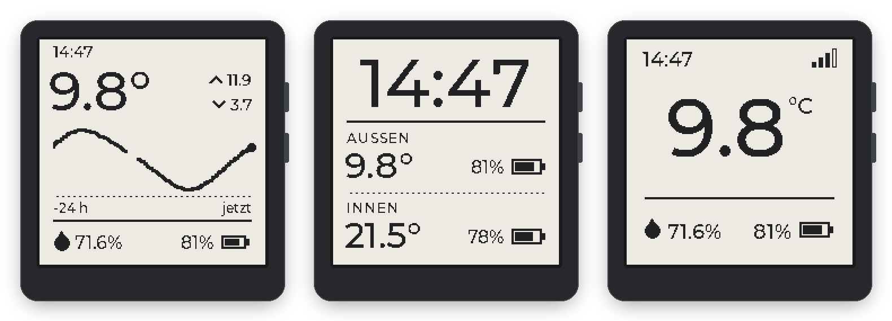
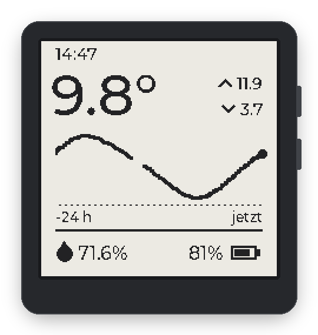
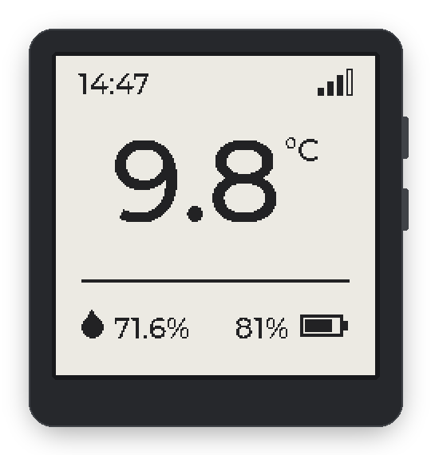
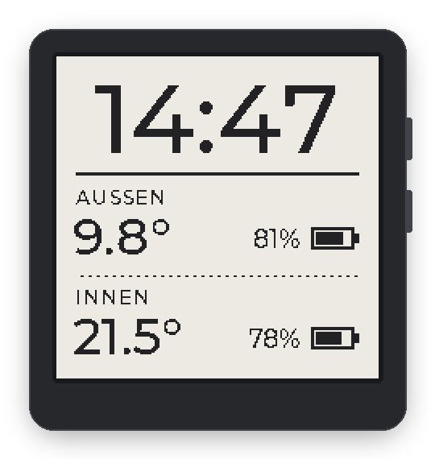
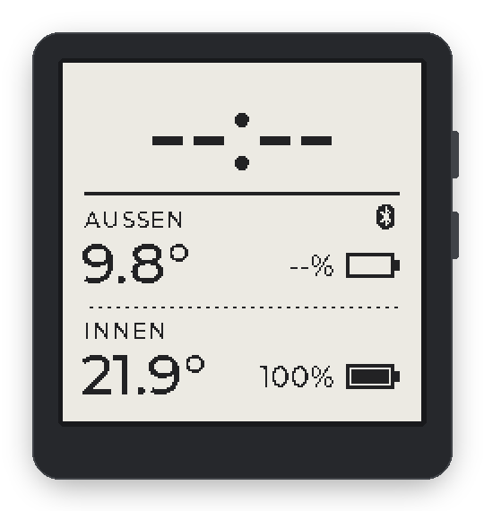
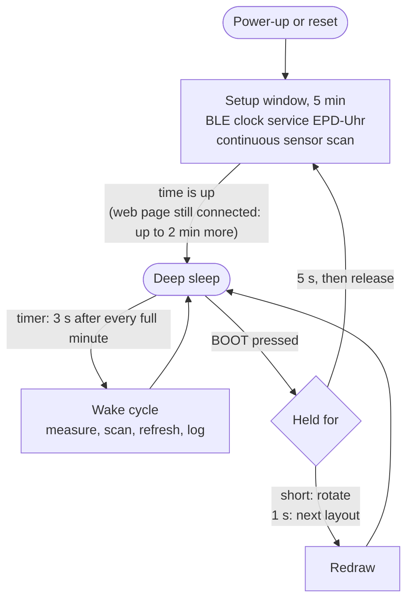
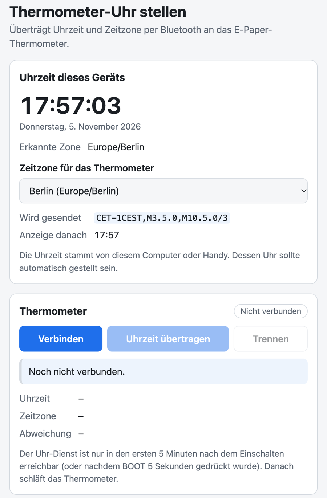

<h1 align="center">ESP32-S3 e-Paper BLE Temperature Display</h1>

<p align="center">
  <b>A Govee Bluetooth thermometer on a 1.54" e-paper clock: battery powered, wakes every minute, sets its clock from the browser and logs to micro SD.</b>
</p>

<p align="center">
  <picture>
    <source media="(prefers-color-scheme: dark)" srcset="docs/images/hero-dark.png">
    
  </picture>
</p>

<p align="center">
  <a href="https://github.com/espressif/esp-idf"></a>
  
  <a href="https://lvgl.io"></a>
  <a href="https://github.com/apache/mynewt-nimble"></a>
  <a href="LICENSE"></a>
</p>

<p align="center">
  <a href="https://matsch82.github.io/waveshare-esp32-s3-ble-temp-viz/"><b>Project page</b></a>
  &nbsp;&middot;&nbsp;
  <a href="https://matsch82.github.io/waveshare-esp32-s3-ble-temp-viz/app/"><b>Clock web app</b></a>
  &nbsp;&middot;&nbsp;
  <a href="#getting-started"><b>Getting started</b></a>
</p>

ESP-IDF firmware for the Waveshare **ESP32-S3-ePaper-1.54** (tested on V2; V1 should work, untested).
It shows a nearby Govee BLE thermometer on the 200x200 black/white e-paper,
runs on the board's LiPo battery with deep sleep, keeps time in the on-board
real-time clock, measures the indoor temperature with the on-board sensor and
writes an hourly CSV log to a micro SD card. No extra wiring is needed.

## Features

- **Outdoor at a glance** - temperature, humidity, sensor battery and signal
  strength from a Govee GV5171 / H5171 thermometer, plus the last 24 hours as
  a curve with maximum and minimum.
- **Indoor as well** - the on-board SHTC3 measures the room temperature; the
  clock layout shows outdoor and indoor side by side, each with its battery.
- **Three layouts, four orientations** - Trend, Focus and Clock, switched and
  rotated with the BOOT button and remembered across power cycles.
- **Built for the battery** - deep sleep between wakes. A wake takes about
  1.5-2.7 s (measured), a partial e-paper refresh about 0.75 s.
- **A real clock** - the PCF85063A RTC keeps UTC on battery power, and a POSIX
  time zone rule handles daylight saving time on the device.
- **Set from the browser** - a single-file web page sets the time and time
  zone over Web Bluetooth. No Wi-Fi, no cloud.
- **Hourly CSV log** - one row per hour on a micro SD card, one file per month.

## Screens

<table>
  <tr>
    <td align="center" width="50%">
      <br>
      <b>Trend</b> (default)<br>
      <sub>Time, temperature, 24 h maximum and minimum, the 24 h curve in 10-minute steps (gaps without readings stay empty), humidity and sensor battery.</sub>
    </td>
    <td align="center" width="50%">
      <br>
      <b>Focus</b><br>
      <sub>Time, one big temperature in 72 px digits, signal bars, humidity and sensor battery.</sub>
    </td>
  </tr>
  <tr>
    <td align="center" width="50%">
      <br>
      <b>Clock</b><br>
      <sub>The time in 60 px digits. AUSSEN: outdoor sensor temperature and its battery. INNEN: on-board SHTC3 temperature and the board battery.</sub>
    </td>
    <td align="center" width="50%">
      <br>
      <b>Setup window</b><br>
      <sub>Right after power-up: <code>--:--</code> until the clock has been set, and the Bluetooth symbol while the clock service is advertised.</sub>
    </td>
  </tr>
</table>

The labels on the device are German: **AUSSEN** = outdoor, **INNEN** =
indoor, **jetzt** = now. Placeholders (`--`) are shown until the first reading
arrives. The SHTC3 sits next to the ESP32 and reads a little warm while the
board stays awake (setup window).

All screen images are rendered on a host from the firmware's real UI code
(`display_ui.c`); they are not photos.

## How it works



**Setup window** (5 minutes after power-up):

1. Read the RTC, apply the stored time zone and show `--:--` until the clock
   has been set once.
2. Advertise the BLE clock service as `EPD-Uhr` (Bluetooth symbol on the display)
   and scan continuously for the sensor (name contains `GV5171`).
3. Redraw at once on a new minute, a button press or a clock change, and on
   new readings at most every 15 s. Unchanged frames are not refreshed.
4. If the web page is still connected when the 5 minutes are up, wait up to
   2 more minutes for it.

**Deep-sleep cycle** (afterwards), on every wake:

1. **Wake** 3 s after each full minute, aligned to the wall clock (a steady
   60 s interval while the clock is unset).
2. **Measure** the indoor temperature (SHTC3) and the board battery (GPIO 4,
   1:2 divider) before the radio adds load to the battery.
3. **Scan** for the sensor for at most 8 s. Its address is remembered, so the
   reading typically arrives in about 1 s. If it is not heard, the last values
   are shown again.
4. **Switch the radio off and refresh** the panel: partial refresh in about
   0.75 s, a full refresh (about 1.85 s) every 15th time.
5. **Log** a CSV row on the first cycle of each hour.
6. **Sleep**: put the panel controller to sleep, cut its supply, hold the
   battery latch (GPIO 17) and enter deep sleep.

Measured on hardware, a wake takes about 1.5-2.7 s in total. Sleep current
and battery life have not been measured.

The last values, the 24 h history and the previous frame for the partial
refresh live in RTC memory: they survive deep sleep, but not a power cycle.

## Setting the clock

The clock is set from a small web page over Web Bluetooth during the setup
window. The firmware itself does not use Wi-Fi.

1. Switch the board on (or, while it sleeps, hold **BOOT** for 5 s and
   release). The Bluetooth symbol appears on the display.
2. Open the **[clock web app](https://matsch82.github.io/waveshare-esp32-s3-ble-temp-viz/app/)**
   in Chrome or Edge and check the time zone.
3. Press **Verbinden** (connect) and pick **EPD-Uhr**.
4. Press **Uhrzeit übertragen** (send time).

The page writes the POSIX time zone first, then the UTC time exactly at a
full second, and reads both back to verify them. It maps the browser's IANA
zone to a POSIX rule from a curated table; the default is Europe/Berlin
(`CET-1CEST,M3.5.0,M10.5.0/3`). A zone that is not in the table is sent as a
fixed offset, so daylight saving time does not switch automatically. The RTC
keeps UTC and runs from the battery even while the board is off.

<p align="center">
  <picture>
    <source media="(prefers-color-scheme: dark)" srcset="docs/images/webapp-dark.png">
    
  </picture>
</p>

### Browser support

Web Bluetooth needs a secure context: `https://` (such as the hosted page) or
`http://localhost`.

| Browser | Works |
|---|---|
| Chrome or Edge, desktop | yes |
| Chrome, Android | yes |
| Safari, Firefox | no (no Web Bluetooth) |
| iPhone and iPad | only with the Bluefy browser app |

### Run the page locally

The page is a single file, `webapp/index.html` (German UI):

```bash
cd webapp && python3 -m http.server 8000
```

Then open http://localhost:8000. From another computer the page must be
served over HTTPS, or the address has to be allowed in
`chrome://flags/#unsafely-treat-insecure-origin-as-secure`.

### Clock service (GATT)

Custom UUIDs, no pairing:

| Characteristic | UUID | Format |
|---|---|---|
| service | `7a6b1000-3c2d-4e5f-9a8b-1c2d3e4f5a6b` | |
| time | `7a6b1001-3c2d-4e5f-9a8b-1c2d3e4f5a6b` | read/write, uint64 LE, Unix seconds UTC |
| time zone | `7a6b1002-3c2d-4e5f-9a8b-1c2d3e4f5a6b` | read/write, POSIX TZ string, 1-48 ASCII bytes |

## SD card log

If a FAT32 card is inserted, the first cycle of every hour appends a row to
`/sdcard/YYYY-MM.csv` (one file per month):

```csv
local_time,utc_epoch,temperature_c,humidity_pct,sensor_battery_pct,rssi_dbm
2026-11-05 14:00:12,1793883612,12.26,63.7,62,-86
```

Rows need a set clock and a reading from the last 10 minutes. Without a card
the attempt fails within a few milliseconds and is retried the next hour.

## BOOT button

| Press | Action |
|---|---|
| Short | Rotate the UI by another 90 degrees clockwise (the default orientation is 90 degrees counter-clockwise). |
| 1 s | Switch to the next layout: Trend, Focus, Clock. |
| Hold 5 s, then release (while sleeping) | Open the setup window again, e.g. to set the clock or to flash new firmware. |

A press also wakes the board from deep sleep. The action runs when the button
is released and is drawn with a full refresh (about 1.85 s).
Orientation and layout are stored in NVS and survive a power cycle.

## Hardware

| Part | Details |
|---|---|
| Board | Waveshare ESP32-S3-ePaper-1.54, V2 (V1 should run the same binary, untested; see [Firmware compatibility](#firmware-compatibility)) |
| Display | 200x200 black/white e-paper, GDEY0154D67 with SSD1681 controller |
| Clock | PCF85063A RTC, I2C address 0x51, kept in UTC |
| Indoor sensor | SHTC3 on the board, I2C address 0x70 |
| Power | the board's LiPo battery, voltage measured on GPIO 4 |
| Storage | micro SD slot, FAT32 card (optional) |
| Outdoor sensor | Govee GV5171 / H5171 BLE thermometer, advertised e.g. as `GV5171385C` (matched by the name containing `GV5171`, case-insensitive) |

No extra wiring is required. On-board connections:

| Signal | GPIO | Notes |
|---|---|---|
| EPD BUSY | 8 | |
| EPD RST | 9 | |
| EPD DC | 10 | |
| EPD CS | 11 | |
| EPD SCLK | 12 | |
| EPD MOSI | 13 | |
| EPD PWR | 6 | active low on V2 |
| VBAT latch | 17 | active high, held during deep sleep |
| BOOT button | 0 | active low; rotation, layout, setup window, wake from deep sleep |
| PWR button | 18 | switches the board on from battery |
| I2C SDA / SCL | 47 / 48 | RTC and SHTC3 |
| Battery voltage | 4 | ADC1 channel 3, 200k/200k divider |
| SD card CLK / CMD / D0 | 39 / 41 / 40 | SDMMC 1-bit |

## Getting started

### 1. Install ESP-IDF

Needs **ESP-IDF v5.5.2** or newer. The setup script (written for macOS)
installs v5.5.2 to `~/esp/esp-idf` if it is missing.

```bash
./scripts/setup.sh          # one-time, ~1 GB download
```

### 2. Build

```bash
./scripts/build.sh
```

Or, with the ESP-IDF environment already sourced:

```bash
idf.py build
```

### 3. Flash

Plug the board in with USB-C. In deep sleep the USB port disappears and only
comes back for the short time of each wake. `scripts/flash.sh` waits up to
70 s for such a wake and flashes with esptool directly, which keeps the chip
in download mode. Holding BOOT for 5 s (setup window) also keeps it awake. If
the port never shows up, hold **BOOT** while plugging in USB (or while pressing
**PWR** on battery) to enter download mode.

```bash
./scripts/flash.sh          # waits for the port and flashes
./scripts/flash.sh monitor  # flash, then open the serial monitor
```

To force a port:

```bash
./scripts/flash.sh /dev/cu.usbmodemXXXX
idf.py -p /dev/cu.usbmodemXXXX flash
```

### 4. Monitor

```bash
./scripts/monitor.sh        # waits for a wake, follows the log without a reset
./scripts/flash.sh monitor  # flash, then the same
```

A wake from deep sleep logs, for example:

```
I (...) sysclock: RTC 2026-11-05 15:53:03 UTC, local 2026-11-05 16:53:03 CET
I (...) ble: GV5171385C: 6.48 C / 77.6 % / 60% batt  rssi -85  packed@2
I (...) ble: stopped
I (...) epd: partial refresh: 745 ms
I (...) main: deep sleep for 57xxx ms
```

The serial port reappears on every wake and the monitor reconnects to it. Both
scripts use `idf.py monitor --no-reset`: a monitor that resets the chip (or
any tool that drops DTR while RTS is still set) restarts the board into the
setup window.

### 5. Set the clock

Use the [clock web app](#setting-the-clock) within the 5-minute setup window.

## Configuration

Application options live in `main/Kconfig.projbuild` (`idf.py menuconfig`,
menu "E-paper display application"):

| Option | Default | Meaning |
|---|---|---|
| `CONFIG_APP_SENSOR_NAME_PREFIX` | `GV5171` | Case-insensitive substring of the sensor's advertised name |
| `CONFIG_APP_FULL_REFRESH_EVERY` | `15` | Full e-paper refresh every N display cycles (the first refresh after boot is always full) |
| `CONFIG_APP_SETUP_WINDOW_SEC` | `300` | Length of the setup window after power-up |
| `CONFIG_APP_WAKE_INTERVAL_SEC` | `60` | Deep-sleep wake interval; aligned to the minute with a valid clock and 60 s |
| `CONFIG_APP_WAKE_SCAN_TIMEOUT_MS` | `8000` | Maximum BLE scan time per wake |
| `CONFIG_APP_SD_LOG_INTERVAL_SEC` | `3600` | SD log interval, aligned to the wall clock |
| `CONFIG_APP_BLE_NAME` | `EPD-Uhr` | BLE name of the clock service in the setup window |
| `CONFIG_APP_DEFAULT_TZ` | `CET-1CEST,M3.5.0,M10.5.0/3` | POSIX time zone used until the web page sends one |

Other settings in `sdkconfig.defaults`:

- `CONFIG_ESP_MAIN_TASK_STACK_SIZE=8192` (do not put the previous framebuffer
  on this stack).
- Custom partition table `partitions.csv` with a 3 MB factory app partition.
- NimBLE with observer, broadcaster and peripheral roles (no central, no
  bonding); LVGL Montserrat 12/14/16/18/20/32/48; the bootloader skips image
  validation after deep sleep.

An existing `sdkconfig` keeps its old settings; delete it once so
`sdkconfig.defaults` is applied again.

## Under the hood

- **ESP-IDF v5.5.2+** on the ESP32-S3, no PSRAM, one binary meant for V1 and V2.
- **NimBLE**: observer role to scan for the Govee advertisement, peripheral
  role for the GATT clock service.
- **LVGL 9.6** renders into a 1-bpp framebuffer with software rotation; a small
  custom SSD1681 driver (`epd_ssd1680.c`, SSD1680-compatible commands) pushes
  it to the panel (partial or full refresh).
- **Custom 60/72 px digit fonts**, generated from LVGL's Montserrat-Medium.ttf
  by `scripts/gen_font.py`.

## Project layout

```
waveshare-esp32-s3-ble-temp-viz/
├── CMakeLists.txt
├── sdkconfig.defaults
├── partitions.csv              # 3 MB factory app partition
├── LICENSE
├── .github/workflows/pages.yml # deploys docs/ and webapp/ to GitHub Pages
├── main/
│   ├── idf_component.yml       # LVGL 9.6 dependency
│   ├── main.c                  # setup window, wake cycle, deep sleep
│   ├── board.c/.h              # GPIO holds, panel rail, SPI2
│   ├── button.c/.h             # debounced BOOT button
│   ├── epd_ssd1680.c/.h        # e-paper driver (full init per refresh)
│   ├── display_ui.c/.h         # LVGL 9 UI + 1bpp framebuffer
│   ├── ble_scanner.c/.h        # NimBLE scan + GATT clock service
│   ├── govee_decode.c/.h       # Govee advertisement decoder
│   ├── history.c/.h            # 24 h temperature ring buffer
│   ├── sysclock.c/.h           # PCF85063A RTC, time zone, I2C bus
│   ├── shtc3.c/.h              # on-board indoor sensor
│   ├── battery.c/.h            # board battery voltage (ADC)
│   ├── sensor_math.c/.h        # SHTC3 CRC/conversion, battery curve
│   ├── civil_time.c/.h         # date math, BCD
│   ├── sdlog.c/.h              # hourly CSV on the SD card
│   ├── sdlog_format.c          # CSV row and file name
│   ├── assets/                 # 1-bit icon, 60/72 px digit fonts
│   └── Kconfig.projbuild
├── scripts/
│   ├── setup.sh
│   ├── build.sh
│   ├── flash.sh                # waits for a wake, flashes with esptool
│   ├── monitor.sh              # waits for a wake, monitor --no-reset
│   ├── gen_icons.py            # regenerates assets/icon_*.h
│   ├── gen_font.py             # regenerates assets/font_digits_<size>.c
│   └── test_govee.sh           # host tests
├── webapp/
│   └── index.html              # Web Bluetooth page to set the clock
├── docs/
│   ├── index.html              # project page (GitHub Pages)
│   └── images/                 # README images, rendered from the UI code
└── test/
    ├── test_govee_decode.c
    ├── test_history.c
    ├── test_civil_time.c
    ├── test_sdlog.c
    └── test_sensor_math.c
```

## Development and tests

The Govee decoder, the history ring buffer, the date and BCD math, the CSV
formatting and the SHTC3/battery conversions are tested on the host without
the ESP toolchain (binaries go to `build_host/`):

```bash
./scripts/test_govee.sh
```

The large digit fonts and the icon are generated by scripts:

```bash
python3 scripts/gen_font.py 60    # writes main/assets/font_digits_60.c
python3 scripts/gen_font.py 72    # writes main/assets/font_digits_72.c
python3 scripts/gen_icons.py      # writes main/assets/icon_*.h and icons.h
```

`gen_font.py` uses the Montserrat-Medium.ttf of the LVGL component in
`managed_components/` (present after the first build); both scripts need
Pillow.

The screen images in `docs/images/` are rendered on a host from the real UI
code in `display_ui.c`, not photographed.

## Firmware compatibility

PSRAM is disabled and the image header is 4 MB, so the same binary is meant
to run on V1 (4 MB flash + 2 MB quad PSRAM) and V2 (8 MB flash + 8 MB octal
PSRAM). Only V2 has been tested; the Waveshare examples use the same pin map
for both.

## License

[MIT](LICENSE). External code is limited to ESP-IDF / LVGL components fetched
at build time.
